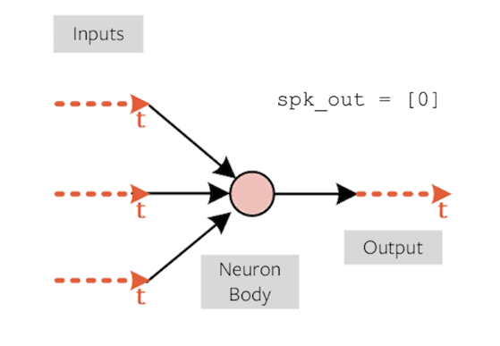

# LIF-Based Spiking Neural Network on FPGA

A hardware-oriented implementation of a **Leaky Integrate-and-Fire (LIF) spiking neural network (SNN)**. This repository contains software-side SNN development notebooks, parameter and training-data files, and FPGA design files intended to support implementation on programmable logic.

The goal of the project is to explore how a spiking-neural-network model can be represented in digital hardware, including neuron parameters, discrete-time state updates, and spike-threshold behavior as well as to implement one from scratch(no frameworks) in software.


## Table of Contents

- [System Overview](#system-overview)
- [Repository Structure](#repository-structure)
- [How It Works](#how-it-works)
  - [1. Software Model Development](#1-software-model-development)
  - [2. Neuron Parameters](#2-neuron-parameters)
  - [3. FPGA Design](#3-fpga-design)
  - [4. Training Data](#4-training-data)
- [Hardware and Tools](#hardware-and-tools)
- [LIF Neuron Background](#lif-neuron-background)
- [Setup and Usage](#setup-and-usage)
- [Verification and Results](#verification-and-results)
---

## Here is a quick demo video to understand how the project works

[](https://www.youtube.com/watch?v=P6Z8AxZ7rmU)


## System Overview

```text
       Model development / experimentation
       ┌───────────────────────────────┐
       │ SNN.ipynb                     │
       │ SNN_Custom_Model.ipynb        │
       └───────────────┬───────────────┘
                       │
                       ▼
       ┌───────────────────────────────┐
       │ Model and data files          │
       │ neuron_parameters.mem         │
       │ snn_training_data.txt         │
       └───────────────┬───────────────┘
                       │
                       ▼
       ┌───────────────────────────────┐
       │ FPGA implementation           │
       │ RTL sources in fpga_files/    │
       │ Constraints: top_snn.xdc      │
       └───────────────────────────────┘
```

This diagram represents the repository's visible workflow at a high level. The exact hardware data path and module hierarchy are described from the RTL source files.

## Repository Structure

```text
LIF-based-SNN-on-FPGA/
├── fpga_files/               # FPGA design sources
├── SNN.ipynb                 # SNN development notebook
├── SNN_Custom_Model.ipynb    # Custom-model notebook
├── neuron_parameters.mem     # Neuron parameter initialization data
├── snn_training_data.txt     # Training-data file
├── top_snn.xdc               # FPGA constraints file
└── README.md
```

### Main files

| File | Purpose |
|---|---|
| `SNN.ipynb` | Notebook for SNN model development and experimentation. |
| `SNN_Custom_Model.ipynb` | Notebook for the custom SNN model. |
| `neuron_parameters.mem` | Hexadecimal parameter rows. The file labels the fields as `w0`, `w1`, `w2`, `d_c`, and `thr`. |
| `snn_training_data.txt` | Training-data file used in the project workflow. |
| `fpga_files/` | FPGA design source files. |
| `top_snn.xdc` | Constraints file. |

## How It Works

### 1. Software Model Development

**Files:** `SNN.ipynb`, `SNN_Custom_Model.ipynb`

The notebooks are the software-side entry points for developing and testing the SNN. Establishing the exact model architecture, training procedure, data preprocessing, and evaluation method.

For a reproducible software-to-hardware implementation, the software model and RTL need to agree on:

- Network topology and the number of neurons and synapses.
- Weight and neuron-parameter values.
- Input encoding and the meaning of each input feature.
- Numeric format, signedness, and scaling.
- The order of operations in each simulation step.
- Membrane-potential leakage and update behavior.
- Threshold comparison and spike-reset behavior.
- Output encoding and the method used to calculate accuracy.

### 2. Neuron Parameters

**File:** `neuron_parameters.mem`

The parameter file contains a comment describing each row as:

```text
w0 w1 w2 d_c thr
```

It then provides six rows of hexadecimal values. The RTL must interpret these fields consistently with the software model.

Before changing this file, confirm the corresponding RTL's:

- Field widths and bit positions.
- Signed or unsigned interpretation.
- Fixed-point scaling, if applicable.
- Memory loading method and row-to-neuron mapping.
- Meaning of `d_c` and `thr` in the implemented update equation.

### 3. FPGA Design

**Directory:** `fpga_files/`

This directory contains the FPGA design sources. The exact top-level module, submodule names, HDL language, clock/reset interface, and hardware datapath should be documented directly from these source files.

At a conceptual level, an LIF-based SNN hardware design may require input handling, weighted input accumulation, membrane-state updates, threshold checks, reset logic, and output generation. These are general functions of LIF SNN implementations.

Models:
1. How input values enter the design.
2. How synaptic contributions are calculated.
3. How each neuron's state is stored and updated.
4. How spikes are generated and reset behavior is applied.
5. How network outputs are produced and exposed.
6. How model parameters are loaded into the hardware.

### 4. Training Data

**File:** `snn_training_data.txt`

This file is part of the repository's data workflow. Its feature columns, label format, row encoding.


---

## Hardware and Tools

| Component | Role / status |
|---|---|
| FPGA RTL sources | Located in `fpga_files/`; the module hierarchy should be taken from the source code. |
| `top_snn.xdc` | Constraint file. |
| Jupyter notebooks | Used for software model development and experimentation. |
| `neuron_parameters.mem` | Stores parameter values in hexadecimal form. |
| `snn_training_data.txt` | Supplies project training data. |
| Vivado | Required to synthesize and implement the RTL. |
| Basys 3 | FPGA board used and programmed towards |

## LIF Neuron Background

A Leaky Integrate-and-Fire neuron accumulates input contributions in a membrane state. The state leaks over time, and a spike is emitted when the state reaches a threshold. The state may then be reset, depending on the chosen neuron model.

A common continuous-time form is:

\[
\tau_m \frac{dV}{dt} = -(V - V_{\mathrm{rest}}) + R I(t)
\]

where:

- \(V\) is the membrane potential.
- \(V_{\mathrm{rest}}\) is the resting potential.
- \(\tau_m\) is the membrane time constant.
- \(R\) is an effective membrane resistance.
- \(I(t)\) is the input current.

A digital implementation uses a discrete update rule and finite-width arithmetic. This equation is background only; the exact equation used by this project must be taken from its notebook and RTL implementation.

## Setup and Usage

### 1. Obtain the repository

```bash
git clone https://github.com/kadgitub7/LIF-based-SNN-on-FPGA.git
cd LIF-based-SNN-on-FPGA
```

### 2. Run the notebooks

Open the repository in Jupyter or a compatible notebook environment and start with `SNN.ipynb`. Then inspect `SNN_Custom_Model.ipynb` to understand how the custom model differs.

### 3. Build the FPGA design

Open the HDL sources in `fpga_files/` using the FPGA vendor's design tools. Select the correct target device and top-level module based on the actual source and board configuration.

Before synthesis or hardware programming:

- Confirm the top-level module and required source files.
- Confirm the target FPGA part number.
- Add valid pin constraints and a clock constraint to `top_snn.xdc`.
- Check that the parameter memory file is referenced using the correct path.
- Run RTL simulation before programming hardware.

No specific synthesis command is given here because the tool version, target device, top-level module, and project-file setup have not been verified.

## Verification and Results

| Evaluation | Record |
|---|---|
| Software model | Dataset, preprocessing, split strategy, and test accuracy or other task-specific metrics. |
| RTL simulation | Test cases, expected versus observed outputs, reset behavior, and corner cases. |
| Software/RTL agreement | Whether the RTL matches the software model for the same inputs and parameters. |
| Synthesis | LUTs, flip-flops, BRAMs, DSPs, or equivalent resources reported by the target tool. |
| Timing | Target clock, achieved clock period, worst negative slack, and timing constraints. |
| Runtime | Latency per inference or simulation window, with the measurement method stated. |
| Power | Tool-estimated or measured power, clearly identifying which one is reported. |
